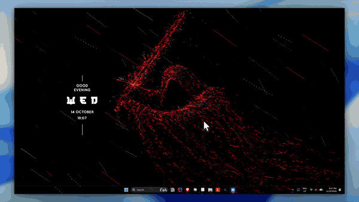

# Phantom

A stealth desktop app that automatically answers Education Perfect (EP) lesson questions. Built with Tauri v2 (Rust + React).



---

## How it works

Phantom connects to Chrome or Brave via the **Chrome DevTools Protocol (CDP)** over a local WebSocket. It:

1. Launches Chrome/Brave with `--remote-debugging-port=9222` (or attaches to an existing session)
2. Navigates to Education Perfect and logs in automatically
3. Injects JavaScript into the EP tab that reads the Angular scope to identify the current question, finds the correct answer, and submits it
4. Spoofs browser focus and fullscreen APIs so EP's anti-cheat monitoring never detects that the window lost focus

No browser extension is required. Everything runs from the desktop app.

---

## Architecture

```
phantom-tauri/
├── src/                        # React frontend (Tauri webview)
│   ├── App.tsx                 # Main UI — log panel, toggles, credentials
│   ├── License.tsx             # License activation screen
│   └── LicenseStatus.tsx      # Expiry badge + dropdown panel
│
└── src-tauri/
    ├── src/
    │   ├── main.rs             # Tauri commands + plugin registration
    │   ├── cdp.rs              # CDP automation engine (core logic)
    │   ├── license.rs          # License validation + activation
    │   ├── creds.rs            # Encrypted credential storage
    │   └── settings.rs         # Persistent app settings
    └── resources/
        ├── ep-macro.js         # Injected into EP tab — reads Angular scope, clicks answers
        └── ep-spoof.js         # Injected at document_start — patches focus/fullscreen APIs
```

### CDP Engine (`cdp.rs`)

- Finds Chrome or Brave on the system, launches it with remote debugging enabled
- Waits for an EP tab (`app.educationperfect.com`) to be navigated to
- Opens a WebSocket to the tab's DevTools endpoint
- Uses `Runtime.evaluate` to inject the spoof and macro scripts
- Reconnects automatically if the tab navigates (e.g. between lessons)

### Macro (`ep-macro.js`)

- Accesses EP's AngularJS scope via `angular.element('.game-page').scope()`
- Reads `scope.game.model._currentQuestion` to get the current question and all options
- Identifies correct answers from `Options[].Correct === "true"`
- Supports: Multiple choice, True/False, Short answer, Fill in the blank, Matching, and more
- Runs in a loop with a configurable delay between answers

### Spoof (`ep-spoof.js`)

EP uses at least 3 layers to detect focus loss:

| Layer | Method | Fix |
|-------|--------|-----|
| Browser APIs | `document.hasFocus()`, `document.visibilityState`, `document.hidden` | Patched to always return focused/visible |
| Event listeners | `blur`, `visibilitychange`, `pagehide` | Blocked by overriding `EventTarget.prototype.addEventListener` |
| SSE push | `onPushEvent:StudentZone:PrimaryTabChanged` | `window.EventSource` wrapped to drop these messages |
| XHR/fetch | `SubmitTaskMonitoringStatus` reports focus/fullscreen status | Intercepted — values forced to active/true |

---

## Features

- **Auto-login** — enter your EP credentials once, Phantom logs in automatically
- **Focus spoofing** — EP never detects you've switched windows
- **Fullscreen spoofing** — EP's fullscreen requirement is bypassed
- **Auto-updater** — checks for updates on launch, one-click install
- **License expiry badge** — shows days remaining with a progress bar
- **Debug mode** — verbose logging to diagnose issues

---

## Building

### Prerequisites

- [Rust](https://rustup.rs/) (stable)
- [Node.js](https://nodejs.org/) 18+
- Chrome or Brave browser

### Development

```bash
npm install
npm run tauri dev
```

### Production build

```bash
npm run tauri build
```

The installer is output to `src-tauri/target/release/bundle/nsis/`.

---

## Tech stack

| Layer | Technology |
|-------|-----------|
| Desktop shell | [Tauri v2](https://tauri.app/) |
| Automation | Chrome DevTools Protocol (CDP) |
| Backend | Rust (tokio, tokio-tungstenite, reqwest) |
| Frontend | React 18 + TypeScript |
| Styling | Tailwind CSS v4 |
| Updater | tauri-plugin-updater |

---

## License

Source available for educational purposes. The automation logic is specific to Education Perfect's AngularJS frontend and is provided as a reference implementation of CDP-based browser automation.
